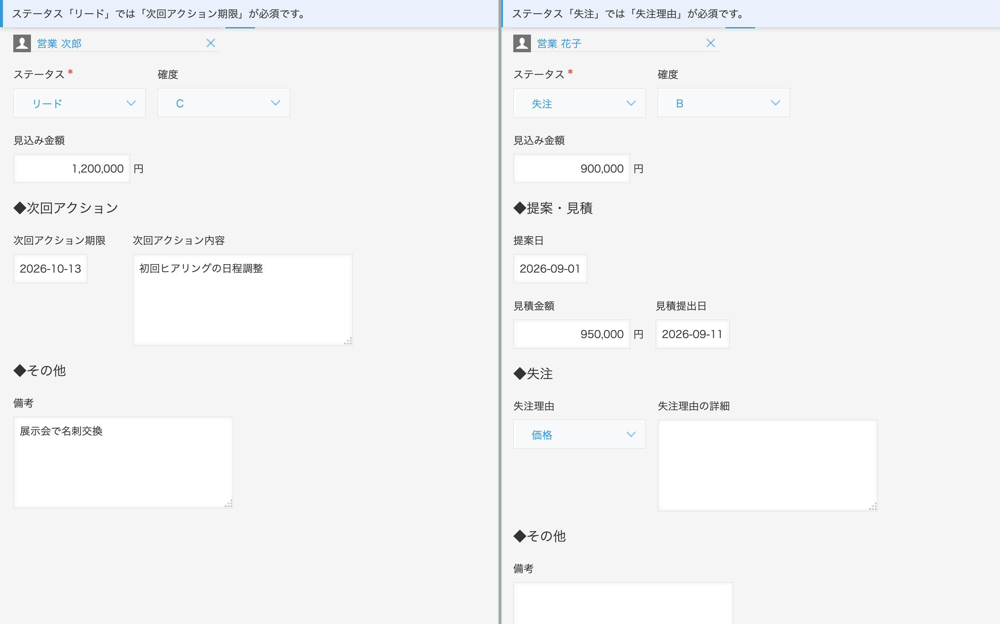
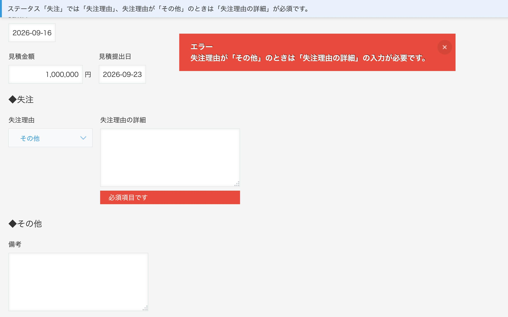
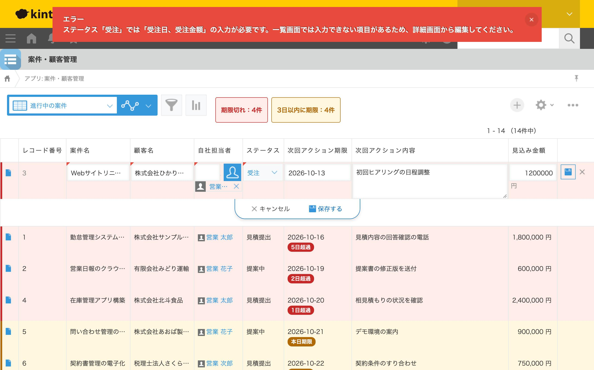
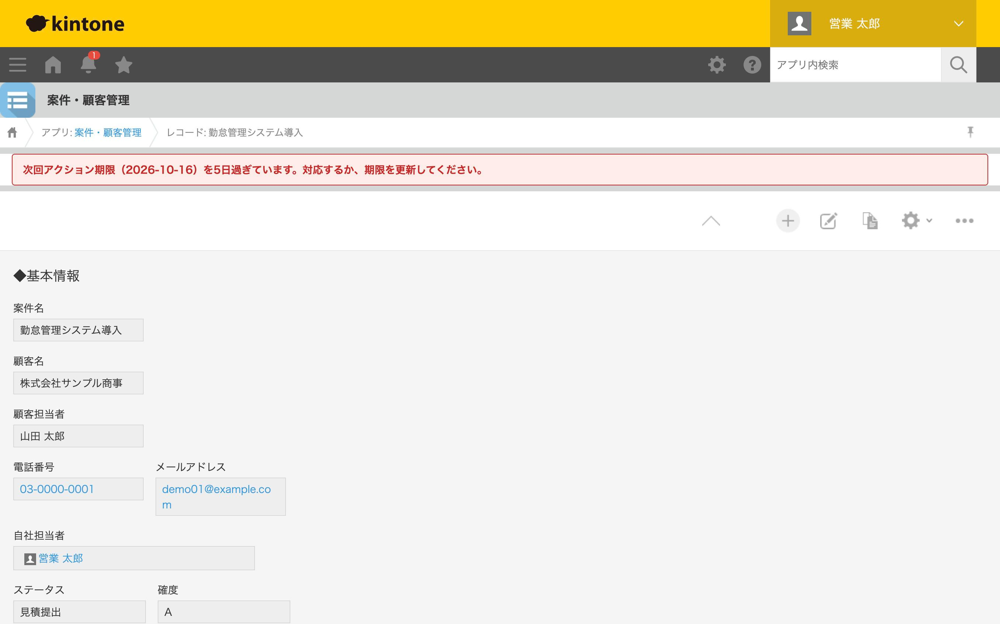

# ① 案件・顧客管理アプリ

困りごと：「Excelの案件管理表をkintoneに移したら、入力漏れと期限切れが増えた」

## 画面イメージ

### 期限が過ぎた・近い案件を色分け
期限切れは赤、3日以内は黄色。「5日超過」「あと1日」のバッジと、アプリ全体の件数も表示します。


### ステータスに応じて入力項目を出し分け
左が「リード」、右が「失注」。その段階で必要な項目と見出しだけが表示され、上部に「いま何が必須か」を固定表示します。



### 必須項目が未入力なら保存しない
失注理由が「その他」のときは詳細の入力が必要、など条件つきの必須チェックにも対応しています。



### 一覧画面からの「抜け道」もふさぐ
一覧で直接ステータスだけ「受注」に変えても、必須項目が空なら保存できません。



### 詳細画面で期限切れを警告



※ スクリーンショットの担当者名は表示用の仮名です。

## ファイル構成

| ファイル | 内容 |
|---|---|
| [docs/01_fields.md](docs/01_fields.md) | kintone で作るフィールドの一覧・一覧画面の設定 |
| [js/deal-management.js](js/deal-management.js) | 入力項目の出し分け・必須チェック・期限の色分け |
| [css/deal-management.css](css/deal-management.css) | 色分け・案内表示の見た目 |
| [docs/02_portfolio.md](docs/02_portfolio.md) | ポートフォリオ用の説明文 |
| [demo-data/deal_demo_data.xlsx](demo-data/deal_demo_data.xlsx) | デモデータ（インポート用、23件） |
| [scripts/make_demo_data.py](scripts/make_demo_data.py) | デモデータを今日の日付基準で作り直すスクリプト |

## 設定手順

1. kintone で新しいアプリを「はじめから作成」し、[フィールド一覧](docs/01_fields.md) の通りにフィールドを作る
2. 「一覧」タブで表形式の一覧を作り、**ステータス** と **次回アクション期限** を必ず含める
3. 「設定」→「JavaScript / CSSでカスタマイズ」を開く
   - 「PC用のJavaScriptファイル」に `js/deal-management.js` をアップロード
   - 「PC用のCSSファイル」に `css/deal-management.css` をアップロード
4. 「保存」→「アプリを更新」

JS・CSSのカスタマイズ設定は、kintone の仕様で **APIトークンでは変更できません**（ログイン状態またはパスワード認証が必要）。そのため手順3〜4は画面から行います。

5. 一覧画面の「…」→「ファイルから読み込む」で `demo-data/deal_demo_data.xlsx` を読み込む

デモデータの期限は作成日を基準にしているため、日がたつと色分けの見え方が変わります。スクリーンショットを撮り直すときは、作り直してから読み込んでください（`ログイン名` は自社担当者に入れる kintone のログイン名）：

```bash
python3 scripts/make_demo_data.py ログイン名
```

## 動作確認のチェックリスト

- [ ] 新規登録でステータスを「リード → 提案中 → 見積提出 → 受注 / 失注」と切り替えると、表示される項目が変わる
- [ ] 画面上部に「ステータス『〇〇』では「…」が必須です。」と表示され、下にスクロールしても画面の一番上に固定される
- [ ] 「見積提出」で見積金額を空にして保存すると、エラーで保存できない
- [ ] ステータスに応じて、見出し（◆次回アクション／◆提案・見積／◆受注／◆失注）も出たり消えたりする
- [ ] 「失注」で失注理由を「その他」にすると、詳細が必須になる（「失注理由が『その他』のときは〜」と表示される）
- [ ] 一覧のインライン編集でステータスだけ「受注」に変えると、エラーで保存できない
- [ ] 期限が過ぎた案件は赤、3日以内の案件は黄色で表示され、「〇日超過」「あと〇日」のバッジが付く
- [ ] 受注・失注の案件は、期限が過ぎていても色が付かない
- [ ] 一覧の上部に、アプリ全体の「期限切れ」「3日以内に期限」の件数が表示される
- [ ] 期限切れの案件の詳細画面を開くと、上部に赤い警告が出る

## 補足

- スマートフォン版の画面には対応していません（モバイル用のイベントは別名のため）。
- 「期限が近い」の日数は JS の `DUE_SOON_DAYS`（初期値 3）で変更できます。
- ステータスごとの表示・必須項目は JS の `STATUS_RULES` にまとめてあり、ここを書き換えるだけで調整できます。
