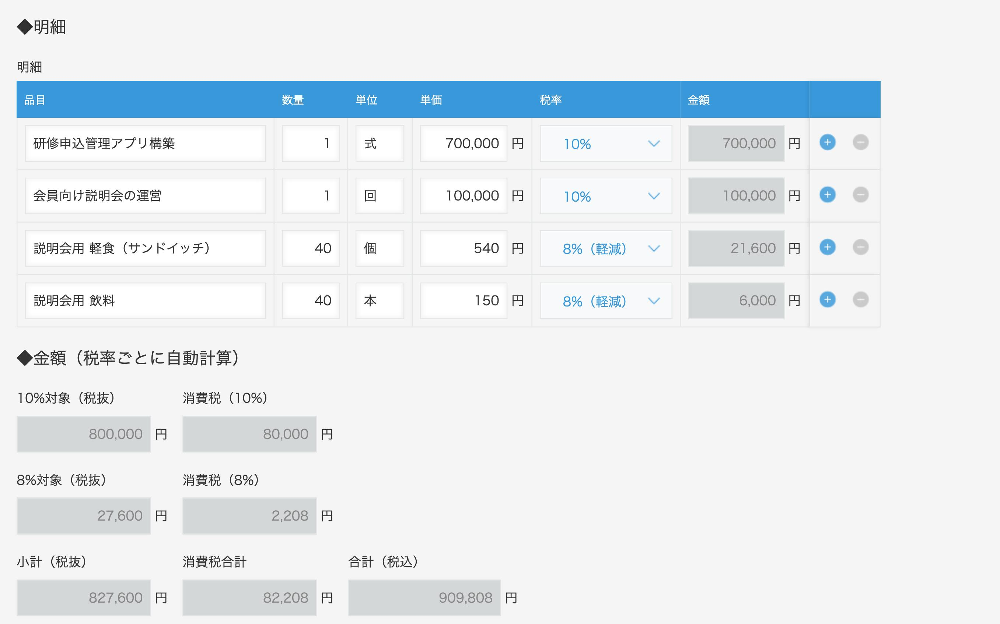
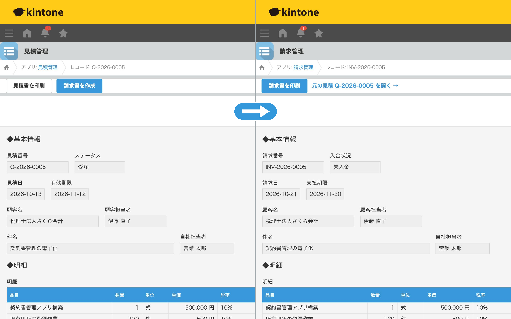
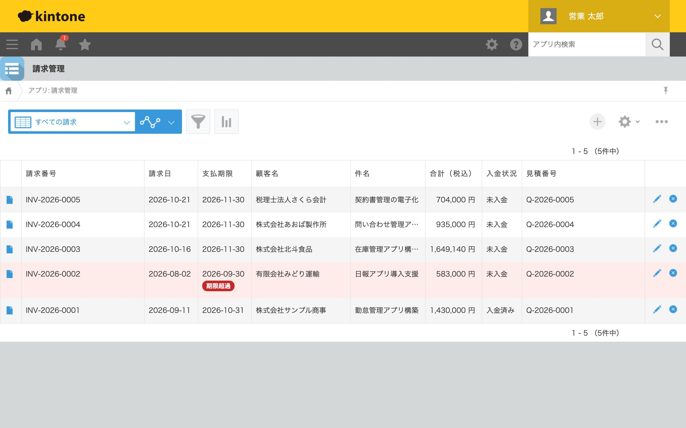

# ② 見積 → 請求 連動アプリ

困りごと：「見積書から請求書を作るとき、同じ内容を何度も手入力している」

**インボイス制度に対応した税計算・自動採番・ボタン1つでの見積→請求の転記・有料プラグインなしの帳票出力** を、kintone の JavaScript カスタマイズと REST API だけで作りました。

## 画面イメージ

### 税率ごとの消費税を自動計算（インボイス制度対応）
明細ごとに税率（10%／軽減8%）を選ぶと、税率ごとの対象額・消費税・合計をその場で計算します。消費税は「税率ごとの合計 × 税率」を1回だけ計算し、端数は切り捨てます。



### 有料プラグインなしで A4 の見積書・請求書を出力
詳細画面の「印刷」ボタンで帳票を表示し、そのまま印刷・PDF保存できます。登録番号・税率ごとの消費税・軽減税率の ※ 印など、適格請求書の記載事項に対応しています。


### ボタン1つで見積 → 請求に転記
「受注」になった見積に「請求書を作成」ボタンが出ます。押すと請求番号を採番し、明細ごと請求管理アプリに登録。見積側は「請求済み」になり、双方にリンクが付きます。



### 支払期限を過ぎた未入金をひと目で
請求一覧で、支払期限を過ぎた未入金の請求を赤く表示します。



※ 帳票の会社名・住所・登録番号・口座はすべて架空のものです。

## 機能一覧

| 機能 | 見積管理 | 請求管理 |
|---|:---:|:---:|
| 税率ごとの金額計算（10%／軽減8%、端数切り捨て） | ○ | ○ |
| 年ごとの自動採番（`Q-2026-0001` / `INV-2026-0001`） | ○ | ○ |
| 有効期限（見積日＋30日）／支払期限（請求日の翌月末）の自動設定 | ○ | ○ |
| A4 帳票の表示・印刷・PDF保存 | 見積書 | 請求書 |
| 見積 → 請求の転記（二重作成の防止つき） | ○ | |
| 「請求済み」を手で選べないようにする（一覧の直接編集も含む） | ○ | |
| 支払期限を過ぎた未入金の強調表示 | | ○ |

## ファイル構成

| ファイル | 内容 |
|---|---|
| [js/common.js](js/common.js) | 両アプリ共通：税計算・採番・日付・帳票の組み立て |
| [js/quote.js](js/quote.js) | 見積管理：自動計算・採番・請求書の作成ボタン |
| [js/invoice.js](js/invoice.js) | 請求管理：自動計算・支払期限・期限超過の表示 |
| [css/style.css](css/style.css) | ボタン・一覧の強調・A4 帳票（印刷用）のデザイン |
| [scripts/schema.mjs](scripts/schema.mjs) | 両アプリのフィールド・フォーム配置・一覧の定義 |
| [scripts/setup.mjs](scripts/setup.mjs) | 定義どおりにアプリを組み立てるスクリプト（REST API） |
| [scripts/seed.mjs](scripts/seed.mjs) | デモデータ（見積10件・請求3件）を登録するスクリプト |
| [docs/02_portfolio.md](docs/02_portfolio.md) | ポートフォリオ用の説明文 |

## 設定手順

1. kintone で「見積管理」「請求管理」の2つのアプリを空のまま作る
2. それぞれ API トークンを発行する（権限：レコード閲覧・追加・編集、アプリ管理）
3. `.env` に URL・アプリID・API トークンを書く（Git には上げない）
   ```
   KINTONE_BASE_URL=https://xxxxx.cybozu.com
   QUOTE_APP_ID=
   QUOTE_API_TOKEN=
   INVOICE_APP_ID=
   INVOICE_API_TOKEN=
   ```
4. アプリを組み立てて、デモデータを入れる
   ```bash
   node scripts/setup.mjs
   node scripts/seed.mjs
   ```
5. `js/common.js` の `APP_ID` に、2つのアプリIDを書く
6. 各アプリの「JavaScript / CSSでカスタマイズ」で、PC用に次の順でアップロードしてアプリを更新する
   - 見積管理：`common.js` → `quote.js`、CSS は `style.css`
   - 請求管理：`common.js` → `invoice.js`、CSS は `style.css`

※ JS・CSS のアップロードは、kintone の仕様で API トークンでは行えないため画面から行います。

## 工夫した設計

- **両アプリで同じフィールドコード**：転記のコードを単純にし、項目を足すときも迷わないようにしています。
- **共通処理は common.js に集約**：税計算と帳票は両アプリで同じものを使うので、片方だけ直し忘れることがありません。
- **アプリの構成をコードで管理**：`schema.mjs` を変えて `setup.mjs` を実行すれば、別の環境にも同じアプリを作れます。
