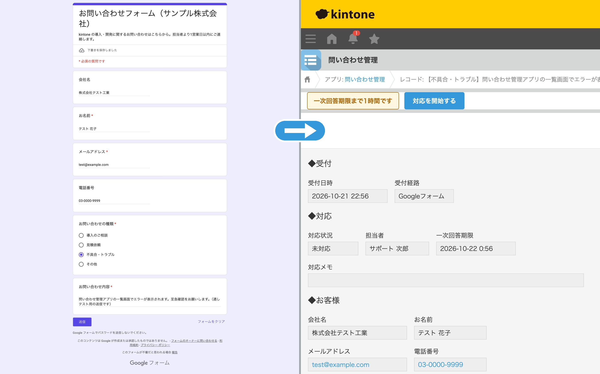
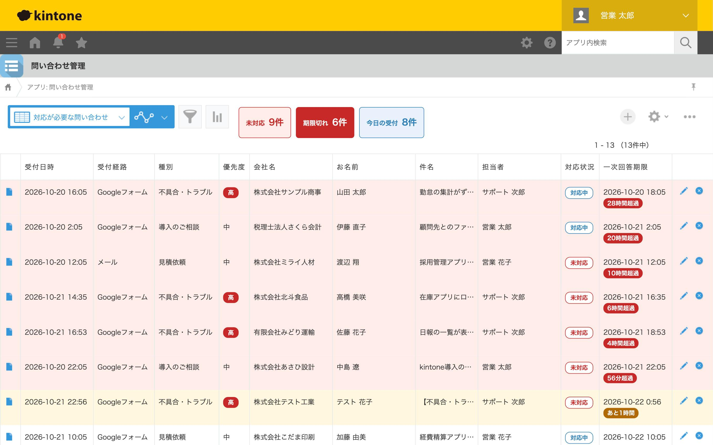
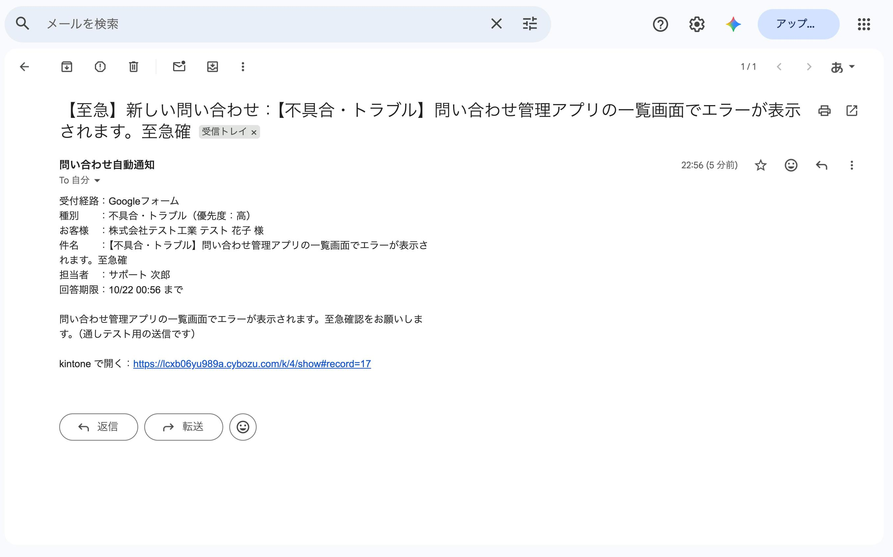

# ③ 問い合わせの自動登録・通知

困りごと：「フォームやメールで来た問い合わせを、毎回kintoneに手で入力している」

**Googleフォームの回答と Gmail の問い合わせメールを、Google Apps Script（GAS）で自動的に kintone へ登録し、担当者に通知します。** 登録された問い合わせは、kintone 側で一次回答期限を管理し、取りこぼしを防ぎます。

## 画面イメージ

### しくみ


### フォームを送信すると、すぐに kintone に登録
左がお客様の入力したGoogleフォーム、右が自動で登録された kintone のレコードです。「不具合・トラブル」と本文の「至急」から優先度「高」と判定し、担当者（サポート 次郎）と一次回答期限（受付の2時間後）を自動で設定しています。



### 返事の遅れをひと目で
一次回答期限を過ぎた問い合わせは赤、迫っているものは黄色。「未対応」「期限切れ」「今日の受付」の件数も上部に表示します。



### 担当者にすぐ通知
優先度が高いものは件名に【至急】が付きます。kintone のレコードへのリンク付きなので、メールからすぐに対応を始められます。



※ 画面の会社名・お名前・連絡先はすべてテスト用のものです。

## しくみ

```
Googleフォーム ──(送信した瞬間)──┐
                                  ├─▶ GAS ─▶ kintone「問い合わせ管理」─▶ 担当者に通知（メール／Chatwork）
Gmail（ラベル付きのメール）─(5分おき)┘      ・種別と本文から優先度・担当者を自動で決める
                                            ・一次回答期限を計算（高2時間／中24時間／低72時間）
                                            ・同じ問い合わせは二重に登録しない
                                            ・失敗したら管理者にメール、メールは次回自動で再登録
```

## 機能一覧

| 場所 | 機能 |
|---|---|
| GAS | Googleフォームの回答を、送信された瞬間に kintone へ登録 |
| GAS | Gmail の「kintone問い合わせ」ラベルが付いたメールを、5分おきに kintone へ登録 |
| GAS | 種別・本文の言葉（「至急」「エラー」など）から優先度を判定し、種別ごとに担当者を割り当て |
| GAS | 担当者へメール通知（Chatwork のトークンを設定すれば Chatwork にも通知） |
| GAS | 連携元ID（フォームの回答ID・メールID）で二重登録を防止。同時実行もロックで防ぐ |
| GAS | kintone が混み合っているときは自動でやり直し。登録に失敗したら管理者にメールで知らせる |
| kintone | 一次回答期限を過ぎた・迫っている問い合わせを色分け（「6時間超過」「あと35分」） |
| kintone | 「未対応」「期限切れ」「今日の受付」の件数を一覧の上に表示（REST API） |
| kintone | 詳細画面に期限の警告と「対応を開始する」ボタン |
| kintone | 優先度を変えると一次回答期限を自動で再計算。「完了」にするときは対応メモを必須に |

## ファイル構成

| ファイル | 内容 |
|---|---|
| [gas/Code.gs](gas/Code.gs) | GAS 本体：フォーム作成・フォーム／メールの取り込み・kintone 登録・通知 |
| [gas/appsscript.json](gas/appsscript.json) | GAS の設定（タイムゾーン・必要な権限） |
| [js/inquiry.js](js/inquiry.js) | kintone：期限の色分け・件数表示・対応開始ボタン・入力チェック |
| [css/inquiry.css](css/inquiry.css) | kintone：色分け・ラベル・件数表示のデザイン |
| [scripts/schema.mjs](scripts/schema.mjs) | kintone アプリのフィールド・フォーム配置・一覧の定義 |
| [scripts/setup.mjs](scripts/setup.mjs) | 定義どおりに kintone アプリを組み立てるスクリプト（REST API） |
| [scripts/seed.mjs](scripts/seed.mjs) | デモデータ（問い合わせ16件）を登録するスクリプト |
| [docs/02_portfolio.md](docs/02_portfolio.md) | ポートフォリオ用の説明文 |

## 設定手順

### kintone

1. 空のアプリ「問い合わせ管理」を作り、API トークンを発行する（権限：レコード閲覧・追加・編集、アプリ管理）
2. `.env` に URL・アプリID・API トークンを書く（Git には上げない）
3. アプリを組み立てて、デモデータを入れる
   ```bash
   node scripts/setup.mjs
   node scripts/seed.mjs
   ```
4. 「JavaScript / CSSでカスタマイズ」で `js/inquiry.js` と `css/inquiry.css` をアップロードしてアプリを更新する

### GAS

1. [Apps Script API](https://script.google.com/home/usersettings) をオンにし、`npx @google/clasp login` でログインする
2. GAS のプロジェクトを作ってコードをアップロードする
   ```bash
   npx @google/clasp create-script --type standalone --title "問い合わせ自動登録（kintone連携）" --rootDir gas
   npx @google/clasp push --force
   ```
   ※ `create-script` で `gas/appsscript.json` が上書きされた場合は、Git の内容に戻してから push する
3. GAS のエディタで「プロジェクトの設定」→「スクリプト プロパティ」に次を設定する
   | プロパティ | 内容 |
   |---|---|
   | `KINTONE_BASE_URL` | `https://xxxxx.cybozu.com` |
   | `KINTONE_APP_ID` | 問い合わせ管理アプリのID |
   | `KINTONE_API_TOKEN` | API トークン（GAS 用には「レコード閲覧・追加」だけのトークンを推奨） |
   | `NOTIFY_EMAIL` | 通知を受け取るメールアドレス |
   | `CHATWORK_API_TOKEN` / `CHATWORK_ROOM_ID` | （任意）Chatwork にも通知するとき |
4. `setup` を実行する（フォームの作成、トリガーと Gmail ラベルの設定）。実行ログにフォームの URL が出る
5. 動作確認：フォームから送信する、または `testRegister` を実行する。メールは「kintone問い合わせ」ラベルを付けると5分以内に登録される

## 工夫した設計

- **API トークンをコードに書かない**：GAS のスクリプト プロパティに保存し、Git にも上がりません。
- **ルールを1か所に**：優先度の言葉・担当者の割り当て・回答期限は `Code.gs` の先頭の設定だけで変えられます。
- **取りこぼしゼロを優先**：フォームの回答は登録に失敗すると内容ごと管理者に送り、メールは「登録済み」ラベルを付けないことで次回自動で再登録します。
