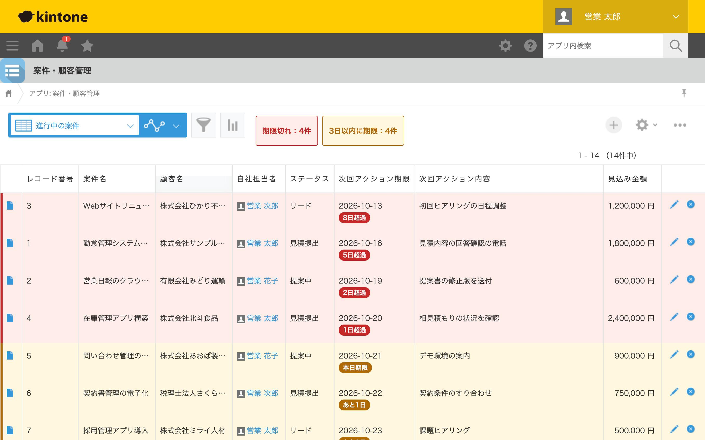
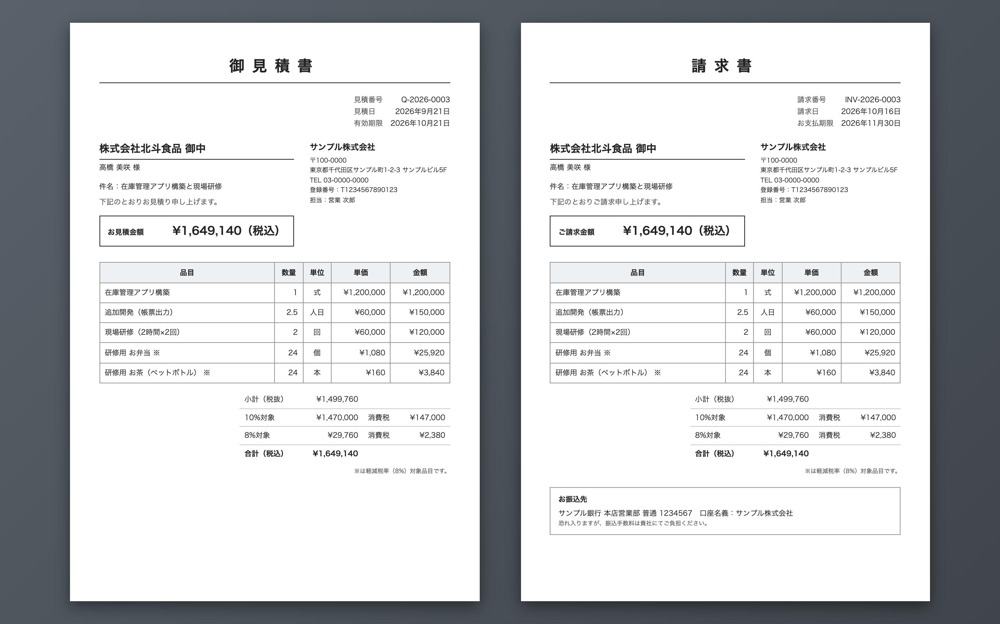
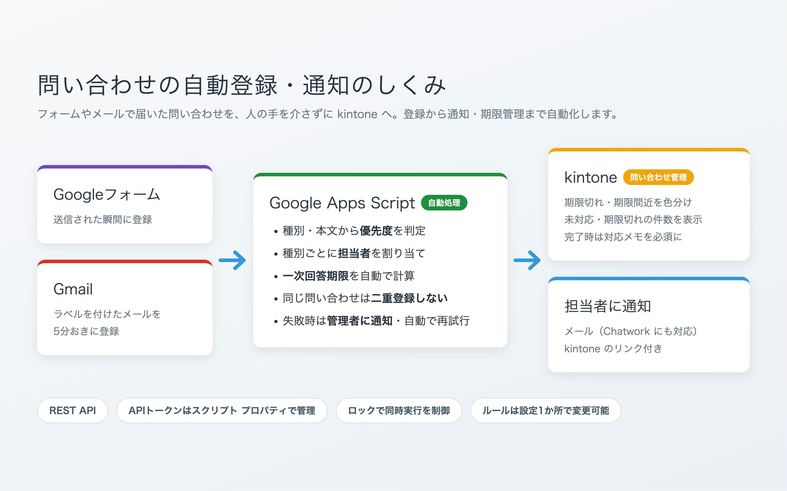

# kintone カスタマイズ デモ集

kintone の現場でよくある「困りごと」を、JavaScript・REST API などで解決したデモアプリです。

| # | アプリ | 困りごと | 主な技術 |
|---|---|---|---|
| ① | [案件・顧客管理](01-deal-management/) | Excelの案件管理表をkintoneに移したら、入力漏れと期限切れが増えた | JavaScript API、REST API、CSS |
| ② | [見積 → 請求の連動](02-quote-invoice/) | 見積書から請求書を作るとき、同じ内容を何度も手入力している | JavaScript API、REST API（アプリ間連携）、印刷用CSS、Node.js |
| ③ | [問い合わせの自動登録・通知](03-inquiry-automation/) | フォームやメールで来た問い合わせを、毎回kintoneに手で入力している | Google Apps Script、REST API、Googleフォーム／Gmail連携、JavaScript API |

各フォルダの README に、画面イメージ・設定手順・動作確認のチェックリストがあります。
ポートフォリオ用の説明（困りごと → 解決 → 工夫した点）は、各フォルダの `docs/02_portfolio.md` にまとめています。

## 動作環境

- kintone（cybozu developer network の開発者ライセンスで動作確認）
- PC版のブラウザ画面
